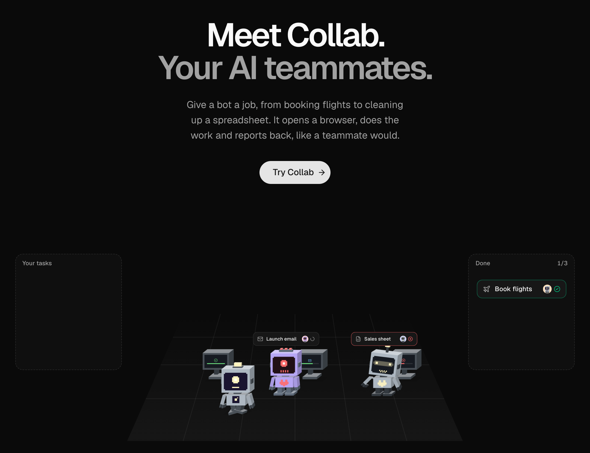
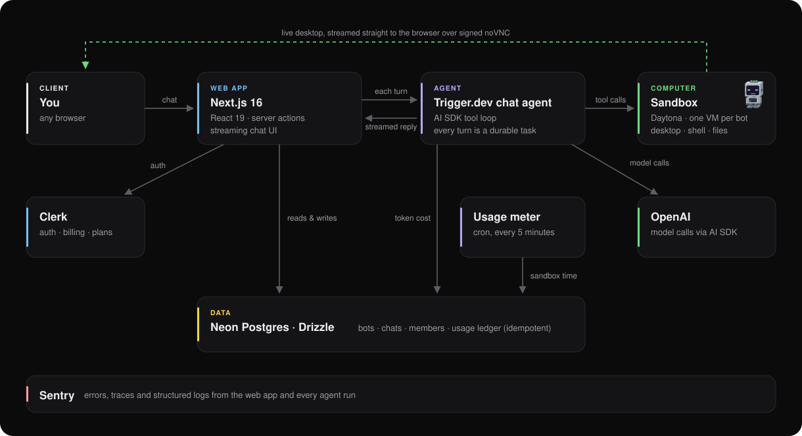

<div align="center">

# Collab

**AI teammates you can hand real work to.**

Each bot gets its own cloud computer with a desktop, terminal and browser. Give it a job and it works on it there, live in front of you, and reports back.

[**Live demo →**](https://collab-production-ea30.up.railway.app)

<sub>🔒 Access is by waitlist for now. Click <b>Try Collab</b> on the site to request access.</sub>




</div>

---

## What it does

Most AI chat apps can only talk. Collab bots can **do**. Every bot you create is backed by its own sandboxed Linux machine, and while it chats with you it can:

- 🖥️ **Use a real computer:** run shell commands, read and write files, open a browser, and drive the desktop with the mouse and keyboard
- 👀 **Work in the open:** the bot's desktop is streamed live into the chat over VNC, so you can watch it click through a site as it works
- 🧠 **Remember you:** each bot keeps its own memory file and carries it across every conversation it's part of
- 👥 **Work as a team:** put several bots in a group chat; when a message fits another bot's job better, a bot hands it off to that teammate
- 🎭 **Have a personality:** every bot has a name, a job, its own instructions and a unique generated voxel avatar

Ask a bot to *"find me a one-way flight from London to Edinburgh on the 27th"* and it will open a browser in its sandbox, search, compare fares and come back with a table of options and a recommendation.

## Architecture

<p align="center">
  
</p>

- **The web app** (Next.js 16, App Router) handles auth, bots, chats and billing through server actions, and renders the streaming chat UI.
- **Every chat turn runs as a durable [Trigger.dev](https://trigger.dev) task** rather than inside a web request. Long, tool-heavy turns (a bot browsing for a minute) aren't bound by serverless timeouts, and replies stream back to the browser in real time.
- **Each bot owns a [Daytona](https://daytona.io) sandbox**, created alongside it. The agent's tools (`bash`, `readFile`, `writeFile`, `listFiles`, screenshots, mouse and keyboard) all execute there, isolated from everything else.

## Engineering highlights

**Durable, tool-using agents.** The chat backend is a Trigger.dev `chat.agent` built on the Vercel AI SDK. A turn loops through model calls and tool calls (shell, files, screen, mouse, keyboard, hand-off) until the bot is done. Transcripts are persisted and reloaded, so a conversation survives refreshes and devices.

**Computer use, end to end.** Bots see their screen through screenshots and act on it with coordinate-based mouse and keyboard tools. The desktop (Xvfb + xfce4) only starts when a task needs it, and the live view is a short-lived signed noVNC URL embedded in a resizable side panel.

**Multi-agent group chats.** In a group, each bot is told who its teammates are and what they do, and gets a typed `handoff` tool. Calling it ends the bot's turn with a reason, and the user can pass the message on to the better-suited bot in one click.

**Usage-based billing with real cost accounting.** Plans come from Clerk Billing (Pro at $20/month), and features are gated server-side. Every turn records its exact token cost; a scheduled task meters running sandboxes every five minutes into the same Postgres usage ledger, with idempotent event ids so retries never double-charge. Each plan's allowance is sized so model and compute spend stays below its price.

**One schema, both sides.** Form validation is derived from the Drizzle tables with `drizzle-zod`, so the client form (react-hook-form) and the server action validate against the same schema, with no hand-written duplicates.

**Observability.** Sentry captures errors, traces and structured logs from both the Next.js app and the Trigger.dev workers, with expected outcomes (like a plan limit) filtered out of the noise.

**A landing page that shows, not tells.** The hero animation uses the exact same DiceBear voxel bots as the app. A small rig regroups the avatar definition's limbs (without changing a single shape or colour) so CSS can make them walk, type, kick and celebrate on a perspective-projected floor. It animates only transforms, pauses when off screen, and respects `prefers-reduced-motion`, with no animation library.

## Tech stack

| Layer | Tools |
| --- | --- |
| Frontend | Next.js 16 (App Router), React 19, Tailwind CSS 4, shadcn/ui, Base UI, AI Elements, Streamdown |
| AI & agents | Vercel AI SDK, OpenAI, Trigger.dev (`chat.agent`, scheduled tasks) |
| Sandboxes | Daytona (per-bot Linux VMs, computer use, noVNC) |
| Data | Neon Postgres, Drizzle ORM, drizzle-zod |
| Auth & billing | Clerk (auth, Billing, feature entitlements) |
| Forms | react-hook-form + zod |
| Observability | Sentry (errors, tracing, logs) |
| Hosting | Railway (web), Trigger.dev Cloud (workers) |

## Running it locally

**Prerequisites:** Node.js 20+, and accounts for Clerk, Neon, OpenAI, Daytona and Trigger.dev (Sentry is optional).

```bash
git clone https://github.com/srivathsan6699/collab.git
cd collab
npm install
```

Create `.env.local` with:

```bash
# Clerk
NEXT_PUBLIC_CLERK_PUBLISHABLE_KEY=
CLERK_SECRET_KEY=
NEXT_PUBLIC_CLERK_SIGN_IN_URL=/sign-in
NEXT_PUBLIC_CLERK_SIGN_UP_URL=/sign-up
NEXT_PUBLIC_CLERK_SIGN_IN_FALLBACK_REDIRECT_URL=/
NEXT_PUBLIC_CLERK_SIGN_UP_FALLBACK_REDIRECT_URL=/

# Neon Postgres
DATABASE_URL=
DATABASE_URL_UNPOOLED=

# Models, sandboxes and agents
OPENAI_API_KEY=
DAYTONA_API_KEY=
DAYTONA_API_URL=
TRIGGER_SECRET_KEY=     # the tr_dev_ key for local development

# Optional
SENTRY_AUTH_TOKEN=
```

Then push the schema and start the app and the agent worker in two terminals:

```bash
npm run db:push          # create the tables in your database
npm run dev              # the web app on http://localhost:3000
npx trigger.dev dev      # the chat agent and scheduled tasks
```

## Project structure

```
app/
  (dashboard)/        signed-in app: chats, usage, pricing
  welcome/            the public landing page
actions/              server actions: bots, chats, group chats, desktops
trigger/              Trigger.dev tasks: chat agent, tools, hand-off, usage metering
lib/
  db/                 Drizzle schema and client
  daytona/            sandbox client and desktop helpers
  billing.ts          plans, features and allowances
  usage.ts            cost accounting and the usage ledger
components/           UI, chat, desktop panel, landing scene
queries/              server-side reads
proxy.ts              routing between the landing page and the app
```

---

<div align="center">

Built by [Srivathsan Suresh](https://github.com/srivathsan6699)

</div>
